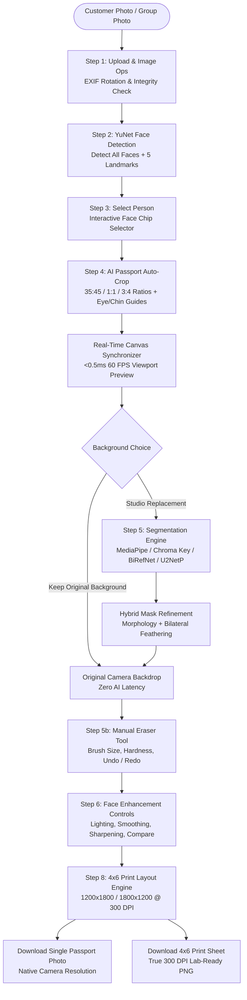

# Snap2Print 🖨️📸

**Local-First, Zero-API-Cost AI Passport Photo Processing & 300 DPI Print Sheet Studio**

Snap2Print is an offline-capable, CPU-optimized desktop web application designed for independent photo studios, copy shops, and passport photo booths. It automates the end-to-end passport photo production pipeline—from multi-person group photos to compliant international passport crops, optional background replacement, manual retouching, face enhancement, and print-ready 4×6 inch multi-copy layouts at 300 DPI.

---

## 📥 Instant Download (Windows Standalone App)

**No Python, terminal, or setup required!** Non-technical users can run Snap2Print directly:

👉 **[Download Latest Release (Snap2Print-Windows-v1.0.0.zip)](https://github.com/shahilkhan2029/Snap2Print/releases/latest/download/Snap2Print-Windows-v1.0.0.zip)**

### How to Run:
1. **Download & Extract**: Download `Snap2Print-Windows-v1.0.0.zip` and extract it anywhere on your PC (`Right-click -> Extract All...`).
2. **Launch**: Open the extracted folder and double-click **`Snap2Print.exe`**.
3. **Use**: The app automatically boots the local AI engine and opens your default browser at `http://127.0.0.1:8000`.

*(Note: If Windows SmartScreen displays "Windows protected your PC", click **More info** $\rightarrow$ **Run anyway**).*

---

## 🌟 The Problem Snap2Print Solves

Small photo studio operators and print shops process dozens of customer passport and visa photos daily. In traditional workflows:
1. **Recurring API Costs**: Cloud background removal services (e.g., remove.bg, clipping APIs) charge $0.20 to $1.00+ per image, eroding small studio profit margins.
2. **Customer Privacy Violations**: Uploading customer and minor portraits or biometric data to third-party cloud servers raises strict legal, privacy, and data-sovereignty concerns.
3. **Hardware Limitations**: Most modern AI segmentation pipelines require expensive NVIDIA GPUs with CUDA, which small storefront print shops cannot afford on modest laptop hardware.
4. **Time-Consuming Manual Editing**: Operators spend 10–15 minutes per customer in Photoshop adjusting aspect ratios, erasing backgrounds, drawing cutting borders, and arranging copies onto 4×6 inch photo paper.
5. **Group Photo Friction**: When family members or couples take a photo together, studios must manually crop, center, and re-process each person one by one.

**Snap2Print eliminates these bottlenecks** with a **100% local, CPU-accelerated, zero-API-cost workstation** running on standard consumer hardware.

---

## 🚀 Key Features

- **Multi-Face Detection & Person Isolation**: Upload a single portrait or group photo; OpenCV YuNet detects all faces with 5 biometric facial landmarks and lets you pick any individual with one click.
- **AI-Assisted Passport Crop & Visual Guidelines**: Pre-computes official passport head sizing with on-screen **Eye Line (40%)** and **Chin Line (70–75%)** alignment guides.
- **International Aspect Ratio Presets**:
  - `35:45` — Standard International Passport (35 × 45 mm)
  - `1:1` — US Passport & Green Card (2 × 2 inches)
  - `3:4` — Standard Portrait & Visa specifications
- **Live 60 FPS Synchronized Preview**: Zero-latency HTML5 canvas preview updates immediately (<0.5 ms) as you drag or resize the crop box.
- **Decoupled Optional Background Workflow**:
  - *Keep Original*: Keeps the customer's natural camera background untouched with **0 ms AI overhead**.
  - *Studio Background Replacement*: Crops first, then segments only the cropped portrait with studio presets (Pure White, Passport Blue, Transparent, or Custom Hex with Opacity adjustment).
- **Manual Eraser Retouch Tool**: Brush-based mask editing directly on the live image (adjustable brush size, hardness, undo/redo stack, and instant reset) without re-running AI inference.
- **Interactive Face Enhancement Architecture**: Real-time slider controls for Strength (0–100), Lighting, Skin Smoothing, Blemish Removal, and Sharpening with Before/After and Split-Screen comparison.
- **Physical 4 × 6 Inch Print Sheet Layout (300 DPI)**:
  - Portrait (`1200 × 1800 px`) and Landscape (`1800 × 1200 px`) physical paper canvas.
  - Automated mathematical grid packing (`cols × rows`) with equal margins and spacing.
  - Crisp solid black cutting borders around each photo.
  - Aspect-ratio locked preview preventing any horizontal or vertical distortion.
- **Dual Export Modes**:
  - Export Single Passport Photo at native camera resolution.
  - Export 300 DPI 4×6 Print Sheet ready for physical mini-lab printing.

---

## 🏗️ Architecture & Workflow



---

## 🤖 Open-Source & Open-Weight AI Components

Snap2Print operates completely locally. All model weights are downloaded automatically on first run and cached in `models/`. No telemetry, external API calls, or cloud dependencies exist.

| Component / Model | File / Checkpoint | Primary Role in Pipeline | Local CPU Inference Time | License & Provenance |
| :--- | :--- | :--- | :--- | :--- |
| **OpenCV YuNet** | `face_detection_yunet.onnx` (~232 KB) | Multi-face detection, bounding boxes, and 5 facial landmarks | **~30–120 ms** | **Open Source** (Apache 2.0)<br>ShiqiYu / OpenCV Model Zoo |
| **MediaPipe Selfie Segmenter** | `selfie_segmenter.tflite` (~249 KB) | Default ultra-fast portrait foreground segmentation | **~10–40 ms** (via XNNPACK CPU) | **Open Source** (Apache 2.0)<br>Google MediaPipe Tasks |
| **U2NetP** | `u2netp.onnx` (~4.7 MB) | Lightweight fallback segmentation for legacy CPUs | **~300–800 ms** (via ONNX Runtime) | **Open Source** (Apache 2.0)<br>Xuebin Qin et al. |
| **BiRefNet-Portrait** | `birefnet-portrait.onnx` (~972 MB) | Optional studio-quality matting for complex hair textures | **~5–12 s** (CPU) | **Open Weight / Open Research** (MIT)<br>Zheng et al. |
| **Analytical Chroma Key** | Algorithmic (`numpy` + `cv2`) | Zero-AI instant green/blue backdrop subtraction | **< 5 ms** | Project Code (MIT / Apache 2.0 compatible) |
| **Hybrid Mask Refiner** | Algorithmic (`cv2`) | Morphology closing, gap healing, bilateral edge transition | **~10–25 ms** | Project Code |

> **Note on Distinction**: YuNet, MediaPipe, and U2NetP are open-source model architectures released under the **Apache 2.0** license. BiRefNet-Portrait is an open-weight deep learning model released under the **MIT** license.

---

## ⚡ Performance & Telemetry

Benchmarks measured on standard consumer laptop hardware (Intel Core i5 / AMD Ryzen 5, CPU-only, 8 GB RAM):

| Pipeline Stage | Processing Method | Measured Latency |
| :--- | :--- | :--- |
| **Image Upload & EXIF Normalization** | Pillow `ImageOps.exif_transpose` | **~10–30 ms** |
| **Multi-Face Detection** | YuNet ONNX (CPU) | **~50–120 ms** |
| **Crop Adjustment & Live Preview** | Offscreen HTML5 Canvas Blit | **< 0.5 ms** (60 FPS) |
| **Background Removal (Chroma Key)** | HSV Distance + Spill Suppression | **~4–8 ms** |
| **Background Removal (Default MediaPipe)** | MediaPipe Selfie Segmenter + XNNPACK | **~15–40 ms** |
| **Background Color Swapping** | Client CSS / HTML5 Canvas | **< 1 ms** (Instant) |
| **Single Passport Export** | Full Camera Resolution Alpha Blit | **~100–300 ms** |
| **4×6 Print Sheet Export** | 300 DPI LANCZOS Compositing (1200×1800) | **~150–400 ms** |

---

## 💻 System Requirements

- **Operating System**: Windows 10/11, macOS 12+, or modern Linux (Ubuntu 20.04+)
- **Python**: Python 3.10, 3.11, or 3.12 (64-bit)
- **Processor**: Standard Dual-Core or Quad-Core CPU (Intel / AMD / Apple Silicon)
- **RAM**: 4 GB minimum (8 GB recommended for large camera RAW/JPEG photos)
- **Disk Space**: ~250 MB for core installation + dependencies (optional BiRefNet model requires ~1 GB)
- **GPU**: **None required** (100% CPU accelerated via ONNX Runtime & TensorFlow Lite XNNPACK)

---

## 🛠️ Installation & Setup

### 1. Clone the Repository
```bash
git clone https://github.com/shahilkhan2029/Snap2Print.git
cd Snap2Print
```

### 2. Create and Activate Virtual Environment

**Windows (PowerShell):**
```powershell
python -m venv .venv
.venv\Scripts\Activate.ps1
```

**macOS / Linux:**
```bash
python3 -m venv .venv
source .venv/bin/activate
```

### 3. Install Dependencies
```bash
pip install --upgrade pip
pip install -r requirements.txt
```

### 4. Run the Application
```bash
python -m uvicorn backend.main:app --host 127.0.0.1 --port 8000 --reload
```

Open your browser and navigate to:
```
http://127.0.0.1:8000
```

---

## 🧪 Running Automated Tests

Snap2Print includes a comprehensive unit and integration test suite:

```bash
# Run 4x6 print layout test suite
python tests/test_print_layout.py

# Run face detection and landmark verification
python tests/test_face_detection.py

# Run decoupled optional background workflow test
python tests/test_optional_bg_workflow.py

# Run restructured workflow integration test
python tests/test_workflow_restructured.py

# Run end-to-end pipeline test
python tests/test_pipeline.py
```

---

## 📁 Repository Structure

```
Snap2Print/
├── backend/
│   ├── api/
│   │   └── photo.py             # FastAPI REST endpoints for upload, crop, seg, export
│   ├── services/
│   │   ├── background_analyzer.py   # Analytical color detection & uniformity scoring
│   │   ├── background_removal.py    # U2NetP ONNX singleton runner
│   │   ├── birefnet_portrait.py     # BiRefNet high-resolution portrait matting
│   │   ├── chroma_key.py            # Analytical HSV green/blue chroma subtraction
│   │   ├── crop_service.py          # Passport standard crop & eye/chin calculators
│   │   ├── face_detection.py        # YuNet multi-face detection & landmarks
│   │   ├── image_compositor.py      # Studio color compositing (White, Blue, Custom)
│   │   ├── image_processing.py      # Image transformations & alpha blending
│   │   ├── mask_refinement.py       # Morphology & bilateral edge feathering
│   │   └── mediapipe_segmentation.py# MediaPipe Selfie Segmenter (Fast CPU)
│   ├── utils/
│   │   └── image_ops.py             # EXIF transpose, format validation, resizing
│   ├── config.py                    # Storage paths, size limits, allowed formats
│   └── main.py                      # FastAPI application setup & static mounting
├── frontend/
│   ├── index.html                   # Studio UI with dual panels, toolbar, 4x6 viewport
│   ├── style.css                    # Professional dark theme & studio design system
│   └── app.js                       # 60 FPS live canvas synchronization & client logic
├── input/                           # Working directory for uploaded originals (.gitignore)
├── models/                          # Downloaded ONNX/TFLite model weights (.gitignore)
├── output/                          # Working directory for generated exports (.gitignore)
├── docs/
│   └── images/                      # Documentation diagrams & architecture assets
├── tests/                           # Automated verification and benchmark suites
├── requirements.txt                 # Python package dependencies
├── .gitignore                       # Production-grade Git ignore specifications
└── README.md                        # Project documentation
```

---

## 📷 Screenshots & UI Walkthrough

Studio interface assets and workflow captures can be placed in [`docs/images/`](file:///d:/0%20Degree/HACKTOBERFEST/Snap2Print/docs/images/):
- **Studio Workspace**: Dual-panel canvas with original photo framing on the left and live 35×45mm passport composition on the right.
- **Group Photo Person Isolation**: Interactive face chips highlighting individual subjects with eye and chin guidelines.
- **Eraser Tool**: Soft-edge brush manually refining segmentation boundaries with undo/redo capability.
- **4×6 Print Sheet Viewport**: True-to-scale physical paper preview rendering 8 copies with black cutting lines.

*(Note: In adherence to privacy standards, personal customer portraits are never committed to version control.)*

---

## ⚠️ Current Limitations

1. **CPU Memory Under Extreme Resolutions**: Processing camera RAW files exceeding 40 megapixels on machines with <4 GB RAM may trigger OS memory limits. Snap2Print automatically downscales working copies to 2048px while maintaining full resolution for final export.
2. **Single Camera Angle Framing**: Passport guidelines assume front-facing or slight-angle customer portraits; extreme side-profile views will trigger a boundary-clamping warning.
3. **Physical Printer ICC Profiles**: Exported images are standard sRGB with embedded 300 DPI metadata. Studio operators using specialized CMYK dye-sublimation printers should calibrate printer color profiles accordingly.

---

## 🔮 Future Improvements

- [ ] Direct integration with local thermal and dye-sublimation photo printers via WebUSB / CUPS.
- [ ] On-device GFPGAN / CodeFormer face restoration module for low-resolution or faded vintage customer photos.
- [ ] Automated ICAO 9303 compliance validation (illumination symmetry, eye gaze verification, reflection detection).
- [ ] Direct batch processing mode for school/corporate ID card generation.

---

## 📄 License

Snap2Print is released under the **MIT License**. Third-party model weights are governed by their respective licenses (YuNet: Apache 2.0, MediaPipe: Apache 2.0, U2NetP: Apache 2.0, BiRefNet: MIT).
